# Embedded India — Turnkey Embedded Hardware & Firmware Engineering Portal

[](https://nodejs.org/)
[-blue.svg)](https://github.com/WiseLibs/better-sqlite3)
[](https://github.com/)
[](tests/)

A modern, tactile, and live B2B embedded engineering platform for **Embedded India** ([https://embeddedindia.in/](https://embeddedindia.in/)). Built with high-performance Node.js, Express, Tailwind CSS with spring physics, SQLite persistence, dynamic project case studies, an offline-capable technical AI Copilot, no-code live site customization, and an automated GitHub Actions CI/CD deployment pipeline to cPanel.

---

## 🌟 Key Features & Architecture

```mermaid
flowchart TD
  subgraph Public ["Public B2B Engineering Portal"]
    A["Interactive Circuit Canvas & Ambient Hero"] --> B["Live Lab Telemetry Banner"]
    B --> C["Smart Cost & Turnaround Estimator"]
    C --> D["Filterable Projects Portfolio (/projects)"]
    D --> E["Deep-Dive Technical Case Studies (/projects/:slug)"]
    E --> F["Ask EI Copilot Floating AI Widget"]
    G["8 Engineering Calculators (/tools)"]
    H["Technical Blog Engine (/blogs)"]
  end

  subgraph Admin ["Admin Command Center (/admin)"]
    I["Dashboard Metrics & KPIs"] --> J["Projects CRUD & AI Drafting Studio"]
    J --> K["Live No-Code Site Customizer"]
    K --> L["6-Theme Unified Palette & Spring Studio"]
    L --> M["AI Technical Article Engine"]
    N["Inquiry & Anti-Spam Management"]
  end

  subgraph Deploy ["Continuous Deployment (CI/CD)"]
    O["git push origin main"] --> P[".github/workflows/deploy.yml"]
    P --> Q["SSH to cPanel Host"]
    Q --> R["./server-deploy.sh update"]
    R --> S["Phusion Passenger Live Reload"]
  end
```



### 1. Modern, Bouncy & "Live" Aesthetics
- **Tactile Spring Physics**: Custom spring cubic-bezier curve (`cubic-bezier(0.34, 1.56, 0.64, 1)`) applied across cards, buttons, and navigation pills with responsive press animations (`scale(0.96)`).
- **60 FPS Circuit Canvas**: Interactive particle and trace mesh that illuminates and connects under the user's cursor.
- **Real-Time Lab Telemetry Ticker**: High-contrast status banner broadcasting active Bangalore lab metrics (SMT lines 1–4 status, HIL automated loopback pass rates, first-pass yield, and average turnaround).
- **Interactive Project Estimator**: Instant turnaround, budget, and engineering team estimator on the homepage responding live to project phase, complexity, and compliance requirements.

### 2. 6 Unified Theme Palettes
Unified the theme engine across the public navigation and admin studio:
1. **Cyber Emerald** (`#0b1412`, `#059669`) — High-contrast default B2B hardware aesthetic.
2. **Quantum Cyan** (`#08101a`, `#0ea5e9`) — Silicon & quantum computing aesthetic.
3. **Titanium Slate** (`#090d16`, `#38bdf8`) — Precision automotive & avionics style.
4. **Solar Amber** (`#18181b`, `#f59e0b`) — Industrial IIoT and factory automation theme.
5. **Supernova Violet** (`#0f0c1b`, `#a855f7`) — Deep space, radar, and RF systems.
6. **Clean Enterprise** (`#f8fafc`, `#2563eb`) — Ultra-clean crisp light mode for enterprise reviews.

### 3. Dynamic Projects Portfolio & Case Studies
- **Filterable Catalog (`/projects`)**: Browse projects by domain (Automotive, CleanTech, Industrial IoT, Edge AI) with live search and bouncy category pills.
- **Deep-Dive Case Studies (`/projects/:slug`)**: Production case studies featuring technical specifications matrices, hardware architecture breakdowns, measurable engineering metrics, and instant RFQ prefill CTAs.
- **Pre-Seeded Showcase Studies**:
  - `bus-ac-controller`: Dual STM32 CAN-FD Automotive Climate Controller.
  - `smart-water-dispenser`: CleanTech IoT Cloud Dispenser with Telemetry & Ultrasonic Sensing.
  - `industrial-lorawan-gateway`: Solar-Powered Edge Gateway with SX1302 and RS485 Modbus.
  - `tinyml-vibration-sensor`: RP2040 Edge AI Predictive Maintenance Vibration Node.

### 4. "Ask EI Copilot" Floating AI Assistant
- **Bouncy Floating Drawer**: Persistent bottom-right drawer with quick prompt chips (Trace Width, MCU Selection, HIL Testing, Turnkey RFQ).
- **Embedded Domain Knowledge Engine**: Offline intelligence answering IPC-2221 PCB trace width calculations, MCU trade-offs (nRF52 vs ESP32 vs STM32), RTOS scheduling, and CAN-FD topologies.
- **Seamless Cloud LLM Fallback**: Easily connects to NVIDIA NIM, Google Gemini, OpenAI, or Ollama when configured in Admin settings.
- **1-Click RFQ Prefill**: Formats technical project briefs directly into `/contact` form queries.

### 5. Upgraded Admin Dashboard (`/admin`)
- **Executive Command Center**: Live KPI counters for total projects, featured studies, page views, inquiries, and newsletter subscribers.
- **Projects CRUD Manager**: Create, edit, re-order, feature toggle, and delete case studies.
- **AI Case Study Generator**: 1-click tool that converts raw engineering notes into formatted technical Markdown case studies.
- **AI SEO Optimizer**: Generates high-CTR meta titles, descriptions, and keywords for projects and articles.
- **Live No-Code Site Customizer (`/admin/customizer`)**: Edit hero copy, typewriter phrases, live lab status text, and toggle individual homepage sections on/off without touching code.
- **Theme & Spring Studio (`/admin/settings`)**: Interactive palette switcher, custom CSS hex injector, and micro-interaction bounce intensity controller (`Modern Bouncy`, `Subtle Smooth`, `Minimalist`).

### 6. Interactive Engineering Calculators (`/tools`)
Client-side interactive engineering tools with dynamic calculation and SVG diagrams:
1. **IPC-2221 PCB Trace Width Calculator**: Mils, mm, resistance, voltage drop, and power loss for internal and external layers across copper weights (0.5 oz to 3 oz).
2. **555 Timer Simulator**: Astable and Monostable modes with live animated square waveforms and NE555 pinout diagrams.
3. **LED Series Resistor Calculator**: Computes resistance, selects closest commercial E12/E24 values, and recommends safety wattage ratings with 2x derating.
4. **UART Baud Rate & Clock Error Calculator**: Computes MCU reload registers (STM32 BRR, AVR UBRR, 8051 TH1) and determines framing error percentage.
5. **SMD Resistor Code Decoder**: Decodes 3-digit, 4-digit, and EIA-96 precision surface-mount resistor codes.
6. **IoT Battery Life Estimator**: Calculates operating lifetime in days and years for wireless nodes based on sleep current and active transmit spikes.
7. **Microstrip Impedance (Zo) Calculator**: Computes 50-ohm and 90-ohm transmission line geometries for high-speed traces.
8. **Interactive MCU Pinout Guide**: Pinout cheat sheets for ESP32, STM32 Blue Pill, and Raspberry Pi Pico RP2040.

### 7. Security & Anti-Spam Architecture
- **3-Layer Anti-Spam Protection**: Silent honeypot input (`website_url_trap`), IP rate limiting, and input sanitization against XSS.
- **HTTP Hardening**: Strict Content Security Policy (`frame-ancestors 'none'`), `X-Content-Type-Options: nosniff`, and HSTS headers.
- **100% Asset Localization**: All SVGs, animations, and typography are bundled locally with zero CDN external script dependencies.

---

## 🚀 Quick Start & Local Setup

### Prerequisites
- Node.js >= 18.x (tested on v20 and v22 LTS)
- npm >= 9.x

### 1. Clone & Install Dependencies
```bash
git clone https://github.com/your-org/embeddedindia.in.git
cd embeddedindia.in
npm install
```

### 2. Initialize Database & Seed Content
```bash
npm run db:init
```
*Creates the SQLite tables with `better-sqlite3`, seeds default admin credentials, 4 case studies, technical blog articles, and customizer settings.*

### 3. Build Styles & Start Development Server
```bash
# Build Tailwind CSS
npm run build:css

# Start Application
npm start
```

Open your browser at:
- **Public Portal:** `http://localhost:3000`
- **Projects Portfolio:** `http://localhost:3000/projects`
- **Engineering Tools:** `http://localhost:3000/tools`
- **Technical Blog:** `http://localhost:3000/blogs`
- **Admin Dashboard:** `http://localhost:3000/admin`
- **Dynamic XML Sitemap:** `http://localhost:3000/sitemap.xml`

---

## 🔒 Default Admin Credentials

| Parameter | Value |
| :--- | :--- |
| **Admin Login URL** | `http://localhost:3000/admin/login` |
| **Email** | `admin@embeddedindia.in` |
| **Default Password** | `AdminEmbedded@2026!` |

*(Configurable via `.env` file)*

---

## 🔄 Automated CI/CD & cPanel Deployment

This repository is linked to the live production server at `embeddedindia.in`:
- Pushing to the `main` branch triggers [`.github/workflows/deploy.yml`](file:///.github/workflows/deploy.yml).
- The action pulls changes via SSH, registers the commit in cPanel Version Control, runs `./server-deploy.sh update`, and triggers an instant Phusion Passenger reload (`tmp/restart.txt`).
- For complete setup instructions and required GitHub secrets, see [DEPLOYMENT_CPANEL_GUIDE.md](file:///DEPLOYMENT_CPANEL_GUIDE.md).

---

## 🧪 Automated Test Suite

Run the full automated test suite:
```bash
npm test
```
The Jest suite validates:
- Core public pages, services, and branding integrity
- Engineering calculator endpoints
- Technical blog slug routing and code highlighting
- XML Sitemap and Robots.txt compliance
- Anti-spam honeypot trapping and XSS sanitization
- Newsletter double opt-in registration
- Admin login, bcrypt verification, and session authentication
